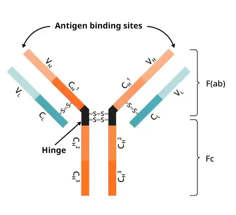

### Front
论述：HIV病毒入侵的过程，以及为什么HIV患者总是死于相关并发症

### Back
#### 1. HIV 病毒入侵与复制的过程
HIV（人免疫缺陷病毒）属于逆转录病毒，主要攻击人体的免疫系统。其侵入宿主细胞及复制全过程可分为以下几个阶段：

* **识别与吸附（Binding & Attachment）**
  病毒表面的包膜糖蛋白 gp120 特异性识别并结合宿主靶细胞（主要是 \(CD4^+\) 辅助性 T 淋巴细胞/TH 细胞、巨噬细胞及树突状细胞）表面的 **CD4 受体**，并与辅受体（如 CCR5 或 CXCR4）结合。
* **膜融合与侵入（Fusion & Entry）**
  gp120 与受体结合后诱导构象改变，促使病毒包膜与宿主细胞质膜发生融合，将病毒衣壳及遗传物质（两条单链 RNA、逆转录酶、整合酶等）释放入宿主胞质溶胶。
* **逆转录与双链 DNA 合成（Reverse Transcription）**
  在胞质中，病毒**逆转录酶（Reverse Transcriptase）**以病毒单链 RNA 为模板催化合成互补 DNA（cDNA）。逆转录酶兼具三种活性：
  1. RNA 指导的 DNA 聚合酶活性；
  2. RNase H 活性（水解切断 RNA/DNA 杂化链中的 RNA 模板）；
  3. DNA 指导的 DNA 聚合酶活性。
  最终合成双链 DNA（dsDNA）。
* **核整合（Integration）**
  双链 DNA 在病毒**整合酶（Integrase）**的协助下穿过核孔进入细胞核，整合到宿主细胞染色体基因组中，形成**前病毒（Provirus）**。
* **转录、翻译与装配成熟（Assembly & Release）**
  前病毒利用宿主 RNA 聚合酶转录生成病毒 mRNA 和基因组 RNA，利用宿主核糖体翻译出病毒前体多肽。子代 RNA 与蛋白颗粒在质膜下装配，以出芽（Budding）方式脱离宿主细胞，经病毒蛋白酶剪切成熟，形成具有感染力的子代病毒颗粒。

#### 2. HIV 患者死于相关并发症的生化与免疫学机制
HIV 本身通常不直接导致患者死亡，而是通过破坏免疫系统引发严重的**获得性免疫缺陷综合征（AIDS）**，使机体丧失抗感染与肿瘤监视能力：

* **\(CD4^+\) TH 淋巴细胞的大量耗竭（免疫枢纽瘫痪）**
  \(CD4^+\) 辅助性 T 细胞（TH 细胞）是真核生物适应性免疫的核心枢纽。HIV 在 TH 细胞内大量出芽复制导致宿主细胞直接裂解死亡；同时被感染的细胞表达病毒抗原后，会被细胞毒性 T 细胞（Tc 细胞）特异性杀伤并诱导广泛凋亡。
* **体液免疫与细胞免疫双重崩溃**
  TH 细胞大量死亡后，无法有效分泌细胞因子（如 IL-2、IL-4 等）：
  * **体液免疫受阻**：B 淋巴细胞缺乏 TH 细胞的辅导与呈递信号，无法正常增殖分化为浆细胞产生特异性抗体；
  * **细胞免疫丧失**：Tc 细胞缺乏 TH 细胞的激活信号，无法有效增殖分化为效应 T 细胞去清除突变细胞或病毒感染细胞；
  * **巨噬细胞功能受损**：抗原呈递与吞噬杀灭能力显著下降。
* **致命性机会感染与恶性肿瘤**
  由于免疫监视与防御屏障彻底崩溃，外界或体内正常菌群中对健康人无害的**机会性病原体**（如卡氏肺孢子虫、结核分枝杆菌、巨细胞病毒、念珠菌等）会在患者体内爆发重度感染（如严重肺炎、脑膜炎、败血症）；同时机体清除癌变细胞的能力丧失，导致恶性肿瘤（如卡波西肉瘤、淋巴瘤）高发，最终引发全身多器官衰竭而死亡。

---

### Front
论述：抗体的结构

### Back

1. **整体四链对称结构**：抗体（免疫球蛋白，Ig）呈对称的“Y”字形单体，由 2 条相同的**重链**（Heavy chain，H链，相对分子质量约为 50~70 kD）和 2 条相同的**轻链**（Light chain，L链，相对分子质量约为 24~25 kD）通过**链间二硫键**及非共价键连接而成。
2. **链的分类与型别**：
   - **重链（H链）**：决定抗体的类别（Isotype），分为 \(\mu\)、\(\gamma\)、\(\alpha\)、\(\delta\)、\(\epsilon\) 五种，分别对应 **IgM、IgG、IgA、IgD、IgE**。
   - **轻链（L链）**：分为 **\(\kappa\)** 和 **\(\lambda\)** 两种类型。
3. **可变区与恒定区**：
   - **可变区（V区）**：位于 H 链和 L 链的 N 端（\(V_H\) 和 \(V_L\)），氨基酸序列高度可变。V 区包含 3 个超变区/**互补决定区（CDRs，即 CDR1、CDR2、CDR3）**，由 \(V_H\) 和 \(V_L\) 的 CDRs 共同组成抗原结合位点。
   - **恒定区（C区）**：位于 H 链和 L 链的 C 端（\(C_H\) 和 \(C_L\)），同一类 Ig 的 C 区序列高度保守，负责介导**激活补体、结合 Fc 受体及穿过胎盘**等效应功能。L 链包含 1 个 \(C_L\) 结构域，IgG、IgA 和 IgD 的 H 链包含 3 个 \(C_H\) 结构域（\(C_H1, C_H2, C_H3\)），而 IgM 和 IgE 的 H 链包含 4 个 \(C_H\) 结构域（\(C_H1 \sim C_H4\)）。
4. **功能片段划分**：
   - **Fab 片段（抗原结合片段）**：由 1 条完整轻链（\(V_L + C_L\)）和重链的 N 端片段（\(V_H + C_H1\)）组成，末端具有抗原结合位点，一个单体 Ig 包含 2 个相同的 Fab 片段，具**双价抗原结合能力**。
   - **Fc 片段（可结晶片段）**：由两条重链 C 端的恒定区（如 \(C_H2 + C_H3\)）配对组成，构成“Y”字形的柄部，用于结合细胞表面的 **Fc 受体**和补体 C1q。
   - **铰链区（Hinge region）**：位于 \(C_H1\) 与 \(C_H2\) 之间，富含脯氨酸和半胱氨酸，赋予抗体分子**柔韧性**，便于 Fab 臂改变角度以结合不同距离的抗原表位。
5. **免疫球蛋白折叠（Ig fold）**：重链与轻链均由重复的球状结构域（每个约 110 个氨基酸残基）折叠而成。结构域由 2 层反平行 \(\beta\)-折叠片（7~9 条 \(\beta\)-链）形成 **\(\beta\)-三明治拓扑结构**，并通过链内二硫键稳定。

---